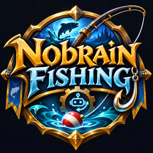

<p align="center"></p>

# Nobrain Companion 🎣

**Nobrain Companion v1.6.1** — экспериментальное приложение для Windows, распознающее поклёвки в World of Warcraft по звуку и/или изменению изображения. Поддерживает локальное окно WoW и удалённые сеансы RustDesk, AnyDesk, TeamViewer.

> **Статус:** персональный экспериментальный проект. Надёжнее всего проверен звуковой режим через RustDesk + VB-CABLE. Визуальный поиск поплавка и работа через AnyDesk/TeamViewer экспериментальны. Использование автоматизации может нарушать правила игрового сервера и привести к санкциям; локальный запуск не является гарантированно безопасным.

## ⚡ Быстрый запуск

1. Установите **Windows 10/11** и **Python 3.11 или 3.12**, включив Python Launcher (`py`).
2. Скачайте ZIP проекта (`Code → Download ZIP` в GitHub), распакуйте в отдельную папку.
3. Запустите **`start.bat`**. Он создаст `.venv` и установит базовые пакеты при первом запуске. Если окружение уже создано, дополнительные пакеты можно установить на вкладке **«Компоненты»** или через `install-components.bat`.
4. Во вкладке **«Звук»** выберите устройство вывода, в котором слышен звук игры. Для бесшумного режима направьте звук клиента удалённого доступа в **VB-CABLE Input** и выберите его же в Nobrain Companion.
5. Убедитесь, что активен готовый образец **`bite_sample.wav`**. Дополнительный пользовательский образец находится в **`samples/bite.wav`**.
6. Выберите **«Звук»** и сначала запустите **без галочки автоматического нажатия**. Проверьте `AUDIO`, `CANDIDATE`, `DETECT` в журнале.
7. Если хотите автоматическое нажатие **Space**, включите соответствующую галочку. Для одного Space на заброс и взаимодействие нужен совместимый аддон **Forever Fishing** и корректная привязка в игре.
8. Выберите **«Удалённо» → RustDesk** или **«Локально» → окно WoW**, затем **«Старт»**.

**Рекомендуемый профиль:** порог звука **0.65**; окно заброса **30 с**; задержка подсечки **0.10–0.25 с**; пауза перед следующим забросом **1.0–2.0 с**; метод клавиатуры **ScanCode**. Значения примерные: качество звука и сетевые задержки влияют на результат.

## Как устроен цикл

```text
SPACE — заброс
  ├─ Поклёвка обнаружена за 30 с → пауза реакции (MIN–MAX) → SPACE
  │                                  → пауза перезаброса (MIN–MAX) → новый заброс
  └─ За 30 с поклёвки нет → пауза перезаброса → новый заброс
```

В автономном аудиорежиме распознавание может работать, пока приложение свёрнуто. **Отправка нажатий требует активного окна игры или удалённого клиента**: при работе в Excel или браузере фоновое управление игрой не гарантируется. Поиск поплавка по изображению сейчас захватывает экран и не видит полностью скрытое/перекрытое окно.

## Основные возможности

- Звуковое сопоставление со скользящим поиском по WAV и автоматической обрезкой основного всплеска.
- Библиотека WAV-образцов, импорт и сохранение выбранного файла.
- Визуальные режимы: изменение пикселей выбранной области; экспериментальный поиск поплавка по фотографии по экрану с динамической областью отслеживания.
- Варианты распознавания: **Звук**, **Пиксели**, **Звук ИЛИ пиксели**.
- Удалённое управление: **RustDesk, AnyDesk, TeamViewer**, автоопределение клиента, попытка вывода его окна на передний план.
- Локальный режим: автоопределение окон WoW и ручной выбор процесса/PID.
- Двойные ползунки MIN/MAX для реакции и паузы; 30-секундный цикл по умолчанию.
- Глобальные хоткеи, статистика сессии, подробный журнал, трей, запоминание позиции окна.
- Проверка и установка компонентов из интерфейса.

## Горячие клавиши

| Комбинация | Назначение |
|---|---|
| `Ctrl + Alt + F6` | Старт / продолжить |
| `Ctrl + Alt + F7` | Пауза / продолжить |
| `Ctrl + Alt + F8` | Стоп |
| `F8` | Аварийная остановка (сохранена для совместимости) |

## Структура

```text
remote_fishing.py           Основное приложение
start.bat                   Запуск и первое создание .venv
install-components.bat      Установка компонентов
install-visual-and-tray.bat Дополнительная установка визуальных пакетов
requirements.txt           Основные зависимости
requirements-optional.txt  OpenCV для автопоиска поплавка
bite_sample.wav             Готовый рабочий звуковой эталон
samples/bite.wav            Дополнительная запись всплеска
assets/nobrain.png          Логотип
assets/nobrain.ico          Иконка Windows
settings.json               Локальные настройки (создаётся программой; не коммитится)
logs/                       Локальные журналы (создаётся программой; не коммитится)
```

## Документация

- [Все настройки приложения](docs/SETTINGS.md)
- [Подключение через RustDesk и бесшумный звук](docs/REMOTE_AUDIO.md)
- [Диагностика и известные ограничения](docs/TROUBLESHOOTING.md)

## Разработка

```powershell
py -3 -m venv .venv
.venv\Scripts\python.exe -m pip install -r requirements.txt -r requirements-optional.txt
.venv\Scripts\python.exe remote_fishing.py
```

На Windows для прямого захвата звука используется WASAPI Loopback. Проверку статического синтаксиса можно выполнить так: `python -m py_compile remote_fishing.py`. Она не подтверждает работу с реальной игрой или удалённой сессией.

**Лицензия:** пока не выбрана. До добавления отдельного файла LICENSE права на код и графику остаются у соответствующих правообладателей.

## Windows EXE без консольного окна (v1.6.1)

Сборка выполняется **на Windows**. Запустите `build-windows.bat` из папки проекта: он создаст `dist/NobrainCompanion/NobrainCompanion.exe` и каталог зависимостей. Запускайте непосредственно `NobrainCompanion.exe` — консоль не появляется, Python на целевом ПК не нужен. Копировать требуется **всю** папку `dist/NobrainCompanion`, а не только EXE.

На GitHub доступен workflow `.github/workflows/windows-build.yml` → Actions → Windows EXE (no console) → Run workflow → скачать artifact `NobrainCompanion-Windows`. Он запускается при наличии исходного `remote_fishing.py` и ресурсов в репозитории.

При первом запуске EXE файлы с образцами и логотипом копируются рядом с приложением, поэтому предпочтительно распаковывать пакет в обычную пользовательскую папку с правом записи. Логи ошибок запуска GUI сохраняются в `logs/fatal-error.log`.

### Работа в фоне

Пока доступно фоновое **распознавание**; отправлять `Space` в неактивное окно удалённого доступа надёжно нельзя. Концепция полноценного режима без удержания RustDesk на переднем плане описана в [docs/BACKGROUND_MODE.md](docs/BACKGROUND_MODE.md): worker на домашнем ПК и удалённый контроллер на рабочем. Этот режим ещё не реализован.


## Защита от чужих всплесков (v1.6.1)

На вкладке **Пиксели** появился режим **«Звук + свой поплавок (строго)»**.
Для подсечки он требует совпадения WAV-образца **и** визуального изменения в области собственного поплавка с интервалом не более 1,5 секунды.
Рекомендуется включить **автопоиск поплавка по фотографии** после каждого заброса.

- Один лишь всплеск (в том числе от соседнего игрока) записывается как `AUDIO | SPLASH CANDIDATE`, но не запускает Space.
- Совпавшие по времени сигналы отмечаются `CONFIRM | OWN BOBBER`.
- Без найденного поплавка подсечка не выполняется: это защита от ложной реакции, но возможны пропуски реальной поклёвки.
- Захват скриншотов сейчас работает по видимому экрану: закрытое другими окнами изображение RustDesk визуальному детектору недоступно.
- Это экспериментальный метод: изменение воды может вызывать ложное визуальное подтверждение. Сперва проверьте 5–10 забросов с отключённой автоматизацией.

Для первоначальной настройки нужны `Pillow`, `opencv-python`, фото собственного поплавка и выбранный аудиовыход.

## v1.6.3 — единый стиль таймингов

- Ползунок «Не подсекать раньше N секунд» теперь использует тот же Canvas-стиль, что и два диапазона MIN/MAX: дорожка, цвет, маркер, подпись и отступы единообразны.
- Ограничение по времени: 0–28 с, шаг 1 с. Режим по умолчанию выключен.
- Вся логика `BITE_IGNORED`, 30-секундного заброса и существующие настройки сохранены.